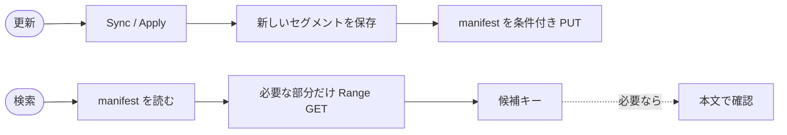
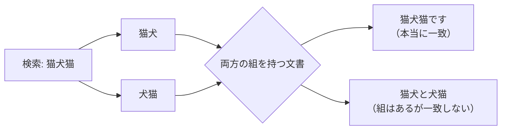
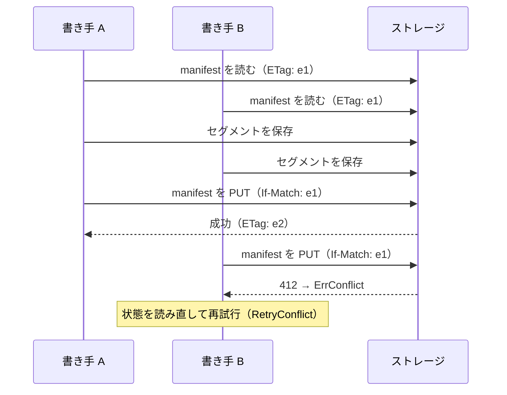
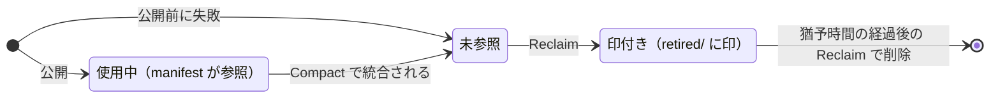

# zenbun

**S3 互換ストレージに置いた UTF-8 テキストを、同じバケット上の索引で部分文字列検索する Go ライブラリと CLI です。**

[](https://github.com/s4na/fts-go-s3/actions/workflows/ci.yml)
[](https://github.com/s4na/fts-go-s3/actions/workflows/e2e.yml)
[](LICENSE)

- **サーバー不要**：索引もバケットに置きます。検索時は索引の必要な部分だけを Range GET で読みます。
- **日本語をそのまま検索**：形態素解析は使いません。NFKC 正規化と文字 bi-gram により、任意の部分文字列を探せます。
- **差分更新**：追加・更新・削除を、索引を作り直さずに反映します。公開は条件付き PUT で原子的に行います。
- **取りこぼしを CI で確認**：10,002 文書・178 クエリで全文走査と照合しています。検索の転送量は全文走査の約 1/1,380 です（[計測](#検証状況と性能)）。

> [!IMPORTANT]
> `Index.Search` が返すのは、検索文字列を**含む可能性がある**文書のキーです。正確な一致が必要なら、[本文で確認する](#候補を本文で確認する)か、本文のコピーごと管理する [`Mirror`](#本文のコピーも管理する-mirror) を使ってください。

> [!NOTE]
> v1.0 より前の段階です。API と保存形式は変わる可能性があります。

## クイックスタート

Go 1.27 以上が必要です。

```sh
go get github.com/s4na/fts-go-s3
```

S3 を用意しなくても、メモリストアで試せます。

```go
package main

import (
    "context"
    "fmt"
    "log"

    zenbun "github.com/s4na/fts-go-s3"
)

func main() {
    ctx := context.Background()

    index, err := zenbun.Open(&zenbun.MemoryStore{}, "indexes/articles/")
    if err != nil {
        log.Fatal(err)
    }

    // 文書のキーと本文を索引に登録する（本文の保存はしない）。
    err = index.Apply(ctx, []zenbun.Change{
        {Key: "articles/a.txt", Data: []byte("日本語の文書")},
        {Key: "articles/b.txt", Data: []byte("英語の文書")},
    })
    if err != nil {
        log.Fatal(err)
    }

    keys, err := index.Search(ctx, "日本語")
    if err != nil {
        log.Fatal(err)
    }
    fmt.Println(keys) // [articles/a.txt]
}
```

## S3 互換ストレージで使う

`articles/` 以下の文書を `indexes/articles/` の索引に同期して検索します。`Sync` は一覧の ETag を比べ、追加・更新・削除された文書だけを反映します。

接続先と認証情報は `S3Config` で渡します。AWS 以外の S3 互換ストレージ（MinIO、Cloudflare R2、VersityGW、SeaweedFS など）でも同じです。

```go
import (
    zenbun "github.com/s4na/fts-go-s3"
    "github.com/s4na/fts-go-s3/s3store"
)

store, err := s3store.NewS3Store(s3store.S3Config{
    Endpoint:  "https://s3.example.com", // 必須。AWS 以外ならそのサービスの URL
    Bucket:    "example-bucket",
    Region:    "us-east-1", // 署名に使う。省略時は us-east-1
    AccessKey: accessKey,   // シークレット管理などから読み込んだ値
    SecretKey: secretKey,
    // AccessKey と SecretKey を両方省略すると、
    // 環境変数 AWS_ACCESS_KEY_ID / AWS_SECRET_ACCESS_KEY / AWS_SESSION_TOKEN を読む。
})
if err != nil {
    log.Fatal(err)
}

index, err := zenbun.Open(store, "indexes/articles/")
if err != nil {
    log.Fatal(err)
}

// ほかの書き手と競合したら、状態を読み直して最大 3 回試す。
err = zenbun.RetryConflict(ctx, 3, func(ctx context.Context) error {
    return index.Sync(ctx, store, "articles/")
})
if err != nil {
    log.Fatal(err)
}

keys, err := index.Search(ctx, "日本語")
```

同じことを CLI でも行えます。CLI は接続先と認証情報を環境変数から読みます。`AWS_` で始まる名前は、AWS 以外の S3 互換ストレージでも aws CLI などと共通の慣習的な名前です。

```sh
export S3_ENDPOINT='https://s3.example.com'
export S3_BUCKET='example-bucket'
export AWS_REGION='us-east-1'           # 省略時は us-east-1
export AWS_ACCESS_KEY_ID='...'
export AWS_SECRET_ACCESS_KEY='...'

go install github.com/s4na/fts-go-s3/cmd/zenbun@latest

zenbun sync    -source articles/ -index indexes/articles/
zenbun search  -index indexes/articles/ '日本語'
zenbun compact -index indexes/articles/
```

本番で使う前に、少なくとも[はじめに守ること](#はじめに守ること)と[索引の手入れ](#索引の手入れ)を読んでください。

## 目次

- [はじめに守ること](#はじめに守ること)
- [仕組み](#仕組み)
- [どの API を使うか](#どの-api-を使うか)
- [索引を更新する](#索引を更新する)
- [本文のコピーも管理する Mirror](#本文のコピーも管理する-mirror)
- [候補を本文で確認する](#候補を本文で確認する)
- [同時更新と競合](#同時更新と競合)
- [索引の手入れ](#索引の手入れ)
- [S3 の設定](#s3-の設定)
- [コマンドライン](#コマンドライン)
- [制限](#制限)
- [検証状況と性能](#検証状況と性能)
- [保存形式と互換性](#保存形式と互換性)
- [開発](#開発)

## はじめに守ること

- **文書は UTF-8 のテキスト**にしてください。画像や PDF からのテキスト抽出は行いません。
- **文書と索引のプレフィックスを重ねないでください。** S3 の一覧は文字列の前方一致なので、`doc` と `docs-index/` は重なります。`doc/` のように末尾の `/` まで指定してください。
- **1 つの索引は 1 つの同期元専用にしてください。** `Sync` は同期元の一覧にないキーを索引から削除します。別の同期元や `Apply` で登録したキーを混ぜると、それらも消えます。
- **索引は自動では更新されません。** 文書を変更したら `Sync` か `Apply` を呼んでください。反映前は、新しい文書が見つからず、削除した文書が候補に残ります。
- **定期的にコンパクションと回収を実行してください。** 詳しくは[索引の手入れ](#索引の手入れ)を参照してください。

## 仕組み

```text
バケット
├── articles/              元の文書（zenbun は読むだけ）
│   ├── a.txt              「日本語の文書」
│   └── b.txt              「英語の文書」
└── indexes/articles/      zenbun が管理する索引
    ├── manifest           現在有効なセグメントの一覧
    └── segments/...       不変のセグメント
```



文書と検索文字列は、**NFKC 正規化**のあと小文字化します。たとえば `ＡＢＣ` と `abc` は同じ扱いです。そのうえで 2 文字ずつの組（**文字 bi-gram**）に分けて索引に記録します。1 文字の検索には 1 文字単位の記録（uni-gram）を使います。

文字の位置は記録しないため、候補には一致しない文書が混ざることがあります。たとえば `猫犬猫` は `猫犬` と `犬猫` に分かれるので、`猫犬と犬猫` も候補になります。



検索結果はキー順で、関連度による順位はありません。

## どの API を使うか

| やりたいこと | 使う API |
|---|---|
| S3 のプレフィックス以下の文書をまとめて索引にする | `Index.Sync` |
| アプリから変更を受け取って、キーと本文で索引を更新する | `Index.Apply` |
| Firebase などの外部データの本文を S3 にコピーし、索引も一緒に更新する | `Mirror.Apply` |
| 候補キーだけ欲しい（本文の確認は自分でする） | `Index.Search` |
| 本文を確認済みの結果が欲しい | `Mirror.Search` / `Mirror.SearchLimit` |
| 統合・不要データの削除 | `Index.Compact` / `Index.Reclaim` |

## 索引を更新する

### Sync：S3 上の文書と同期する

```go
err := zenbun.RetryConflict(ctx, 3, func(ctx context.Context) error {
    return index.Sync(ctx, store, "articles/")
})
```

- 変更は最大 1,000 文書ずつ公開します。途中でエラーになった場合、それまでのバッチは反映済みです。状態を読み直して再実行すると、続きから同期します。
- 一覧と本文の読み取りは別々に行います。同期中は同期元の文書を変更しないよう、呼び出し側で調整してください。一覧の後に ETag が変わったことを検出した場合は `ErrConflict` を返します。ただし、同期元全体の一覧が一瞬の状態を表すことは保証しません。
- 大量に同期するとセグメントが増え、検索で読む量が増えます。同期後は `zenbun compact` を実行するか、`Compact` を `false` が返るまで繰り返してください。

### Apply：変更を直接渡す

```go
err := index.Apply(ctx, []zenbun.Change{
    {Key: "articles/a.txt", Data: []byte("新しい本文")}, // 追加または置き換え
    {Key: "articles/b.txt", Delete: true},              // 削除
})
```

`Apply` はバッチ全体を 1 回で公開します。同じキーを 1 つのバッチに 2 回含めることはできません。**`Apply` は索引を更新するだけで、元の文書を保存・削除しません。**

## 本文のコピーも管理する Mirror

元データが S3 以外（Firebase など）にある場合、`Mirror` を使うと、本文の S3 へのコピーと索引の更新をまとめて行えます。検索時はコピーした本文で一致を確認し、本文付きの結果を返します。元データの取得や変更通知の受け取りはアプリ側で行います。

```go
mirror, err := zenbun.NewMirror(index, store, "copies/articles/")
if err != nil {
    log.Fatal(err)
}

// 元データの追加・更新・削除を受け取ったら渡す。
err = mirror.Apply(ctx, []zenbun.Change{
    {Key: "article-1", Data: []byte("日本語の記事です")},
    {Key: "article-2", Delete: true},
})
if err != nil {
    log.Fatal(err) // 変更を保持したまま、同じバッチを再試行する。
}

// 本文で一致を確認した結果を最大 20 件返す。
results, err := mirror.SearchLimit(ctx, "日本語", 20)
for _, doc := range results {
    fmt.Printf("%s: %s\n", doc.Key, doc.Data)
}
```

- 文書 ID には `user/123` のように `/` を含められます。ただし、空・`.`・`..` の要素は使えません。
- コピーと索引のプレフィックスを重ねないでください。また、`Mirror` で使う索引に `Index.Apply` や `Index.Sync` を直接混ぜないでください。
- **コピーの更新と索引の公開は 1 つのトランザクションではありません。** `Mirror.Apply` は次の順に処理します。

  ```mermaid
  sequenceDiagram
      participant App as アプリ
      participant M as Mirror
      participant C as コピー（copies/）
      participant I as 索引
      App->>M: Apply(変更のバッチ)
      M->>C: 追加・更新分を PUT
      M->>I: 索引を公開（manifest を条件付き PUT）
      M->>C: 削除分を DELETE
      M-->>App: 成功 / エラー
      Note over App,I: どこで失敗しても、同じバッチを後続より先に再試行する
  ```

  途中で失敗すると、コピーだけが新しい状態、または削除済みのはずのコピーが残る状態になることがあります。変更通知は永続的に保持してください。同じ `Mirror` への書き込みは全プロセスで直列化し、失敗したバッチは後続の変更より先に再試行してください。`Mirror` 自体は通知の保存・順序制御・自動再試行を行いません。
- `Mirror.Search` は候補ごとにコピーの本文を 1 回 GET します。短い検索語や頻出語では、ほぼ全文書を読むことがあります。`SearchLimit` は指定件数に一致したところで本文の取得を止めますが、索引の候補はすべて取得します。続きのページを取得する機能はありません。
- コピーが見つからない場合は、空の結果ではなくエラーを返します。

## 候補を本文で確認する

`Index.Search` の候補から正確な結果を得るには、本文と検索文字列を同じ方法で正規化し、部分一致を確認します。

```go
import (
    "strings"

    "golang.org/x/text/unicode/norm"
)

func containsQuery(body, query string) bool {
    normalize := func(s string) string {
        return strings.ToLower(norm.NFKC.String(s))
    }
    return strings.Contains(normalize(body), normalize(query))
}
```

これは**正規化後の一致**の確認です。文字幅や大文字・小文字まで区別したい場合は、元の本文と検索文字列で追加の確認をしてください。本文の確認では、新規追加・更新に伴う取りこぼしは補えません。先に索引へ変更を反映してください。

## 同時更新と競合

索引の部品（セグメント）を先に保存し、最後に**マニフェスト**を条件付き PUT で差し替えます。



- マニフェストの差し替え前に処理が止まった場合、読み手は更新前の索引を読み続けます。
- 複数の書き手が同じ状態から更新した場合、一方の変更を黙って上書きせず、`ErrConflict` を返します。`RetryConflict` で再試行できますが、再試行のたびに状態を読み直してください（上の `Sync` の例のように、関数の中で読み直す処理を呼びます）。
- 書き手間のロックや競合の調停は提供しません。
- マニフェストの書き込み中に通信が切れた場合、サーバー側では更新が完了している可能性があります。結果が不明なときは、索引の状態を確認してから再試行してください。
- 読み取りは一時的なエラーを指数バックオフで再試行します。書き込みと削除は、結果が不明なときの競合を避けるため自動では再試行しません。

## 索引の手入れ

更新を重ねるとセグメントが増え、検索で読む量とマニフェストが大きくなります。運用中は、次の 2 つを定期的に実行してください。

1. **コンパクション**（`Compact` / `zenbun compact`）：隣り合うセグメントをまとめます。Go API は 1 回の呼び出しで最大 1 組をまとめ、まとめた場合に `true` を返します。CLI は、まとめられる組がなくなるまで繰り返します。
2. **回収**（`Reclaim` / `zenbun reclaim`）：参照されなくなったセグメントに印を付け、猶予時間が過ぎた後の実行で削除します。1 回目の実行ではすべては消えません。



回収の猶予時間は、**読み取り操作の最大時間・マシン間の時計のずれ・ストレージの一覧の遅延の合計より長く**してください。読み取り操作の最大時間とは、検索・同期・コンパクションが索引を読み始めてから読み終えるまでの最長時間です。回収を実行するすべてのプロセスが、この前提を守る必要があります。上限を保証できない環境では、安全に回収できません。

```sh
zenbun reclaim -index indexes/articles/ -grace 24h
```

## S3 の設定

- **認証**：静的なアクセスキーで署名（SigV4）します。匿名アクセス、IAM ロール、IMDS には対応していません。認証情報はリポジトリに書き込まないでください。認証情報は次の順で決まります。

  | 優先 | 取得元 | 条件 |
  |---|---|---|
  | 1 | `S3Config` の `AccessKey` / `SecretKey` / `SessionToken` | `AccessKey` と `SecretKey` の少なくとも一方を指定した場合（このとき環境変数は読まない） |
  | 2 | 環境変数 `AWS_ACCESS_KEY_ID` / `AWS_SECRET_ACCESS_KEY` / `AWS_SESSION_TOKEN` | `AccessKey` と `SecretKey` を両方省略した場合 |

  最終的に `AccessKey` と `SecretKey` がそろわない場合、`NewS3Store` はエラーを返します。
- **リージョン**：S3 互換ストレージでも署名の計算に使います。省略時は `us-east-1` です。多くの互換ストレージはこの値のまま動きます。動かない場合は、サービスの指定に合わせてください。
- **アドレス形式**：標準ではパス形式を使います。`VirtualHost: true` でバーチャルホスト形式に切り替えられます。
- **HTTP**：標準のタイムアウトは 30 秒です。`HTTPClient` を渡す場合は、タイムアウトを自分で設定してください。検索は最大 8 並列で GET するため、`http.Transport` の `MaxIdleConnsPerHost` を 8 以上にすると接続を再利用しやすくなります（同時接続数の上限ではありません）。
- **必要な機能**：Range GET、一覧、削除、原子的な条件付き PUT、強い読み取り・一覧整合性が必要です。CI では VersityGW と SeaweedFS で検証しています。Amazon S3 自体はまだ検証していません。
- **詳細**：IAM 権限・プレフィックス・競合は [S3 運用上の前提](docs/storage-operations.md) を、`Store` の契約と対応ストレージは [ストレージ互換性](docs/compatibility.md) を参照してください。

独自のストレージを使う場合は、`zenbun.Store` インターフェース（`Get` / `Put` / `Delete` / `List`）を実装してください。

## コマンドライン

```sh
go install github.com/s4na/fts-go-s3/cmd/zenbun@latest
```

| コマンド | 内容 |
|---|---|
| `zenbun sync -source <prefix> -index <prefix>` | 同期元を索引に反映（競合時は最大 3 回再試行） |
| `zenbun search -index <prefix> <query>` | 候補キーを 1 行に 1 つ表示 |
| `zenbun compact -index <prefix>` | まとめられるセグメントがなくなるまでコンパクション |
| `zenbun reclaim -index <prefix> -grace <期間>` | 不要なセグメントを回収（`-grace` は `24h` や `90m` の形式、既定値 `24h`） |

共通オプションは `-endpoint`、`-bucket`、`-region`、`-virtual-host` です。最初の 3 つは、省略すると `S3_ENDPOINT`、`S3_BUCKET`、`AWS_REGION` の値を使います。認証情報はオプションでは渡せません（プロセス一覧に秘密情報が見えないようにするため）。環境変数 `AWS_ACCESS_KEY_ID` / `AWS_SECRET_ACCESS_KEY`（一時的な認証情報なら `AWS_SESSION_TOKEN` も）を設定してください。`zenbun` が見つからない場合は、`$(go env GOPATH)/bin` が PATH に含まれているか確認してください。キーに改行を含む場合は、出力を区別しやすい Go API を使ってください。

## 制限

- 空のクエリや、UTF-8 でない文書・キーは使えません。
- 形態素解析、関連度順のランキング、AND 以外の演算子、ページングは提供しません。
- マニフェスト、辞書ブロック、辞書目次、各エントリーの上限はそれぞれ 64 MiB です。上限を超える書き込みは、公開前にエラーになります。
- マニフェストのサイズはセグメント数に比例します（文書数ではありません）。1 件の更新では、セグメントとマニフェストの 2 回の PUT を行います。

## 検証状況と性能

CI の [Corpus oracle and measurements](.github/workflows/oracle.yml) は、Wikipedia 10,000 文書と青空文庫 2 作品に対して 178 クエリの結果を全文走査と比較します。この条件で取りこぼしが 0 件であることを確認しています。

メモリストアで 1,000 文書ごとにセグメントを作った計測（main、2026 年 10 月時点）の結果は次のとおりです。

| 指標 | 値 |
|---|---|
| 1 クエリあたりの GET | 平均 71.4 回 |
| 1 クエリあたりの受信量 | 平均 約 134 KB |
| 全文書を 1 回ずつ読む場合との比 | 約 1/1,380 |
| 1 件更新の PUT | 2 回 |

対象は索引検索の GET の応答本文です。HTTP ヘッダーや、候補の本文確認の読み取りは含みません。実ストレージでの検索遅延を表す数値でもありません。最新の値は CI の実行結果のサマリーに表示されます。

**100,002 文書での転送量と取りこぼしは未検証です。** 大規模な計測は CI のジョブの上限（10 分）以内に完了しませんでした。

## 保存形式と互換性

マニフェストとセグメントには形式バージョンがあり、知らないバージョンは読み込みません。新しいセグメントは**保存形式 v2** で書きます。v1 と v2 の両方を読めますが、v2 を書いた索引は古いライブラリでは読めません。同じ索引を複数のプロセスで使う場合は、書き込みを止めて全プロセスを更新してから再開してください。

正規化ライブラリの更新で正規化結果が変わった場合は、索引を元の本文から作り直す必要があります。詳しくは [保存形式の仕様](docs/format.md) を参照してください。

## 開発

CI は単体テスト、S3 互換ストレージでの E2E テスト、コーパスを使った照合と計測を実行します。

Dependabot は、Go モジュール・GitHub Actions・CI のストレージイメージの更新を毎週確認し、リリースから 7 日以上たった版を提案します。セキュリティ更新は GitHub の仕様により、この待機期間の対象外です。GitHub Actions の依存は `.github/workflows/actions.lock` に記録しています。Action を追加・変更した場合は、`gh-actions-lock` 拡張で lockfile を更新してください。

## ライセンス

[MIT License](LICENSE)（Copyright (c) 2026 s4na）
