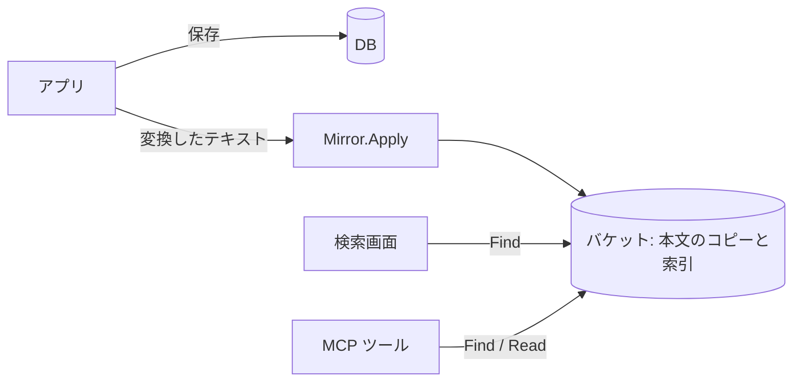

# アプリに組み込む

zenbun を既存のアプリ（例: wiki）に検索機能として組み込むときに、運用で決めることをまとめます。ここでは、次の 2 つの使い方を想定します。

- **手動検索**：利用者が画面から検索し、結果を一覧する。
- **MCP 経由の検索**：LLM がツールとして検索し、抜粋を読んで必要な部分だけを追加で読む。

## 構成

アプリの DB を正（source of truth）とし、zenbun の索引は**検索用の写し**として扱います。



- 本文がバケットにない場合は、`Mirror` を使います。`Mirror` は本文のコピーと索引を同じバケットに置くので、`Find` と `Read` が本文を読めます。
- 本文がすでにバケットにある場合は、`Index.Sync` と `Index.Find(ctx, store, ...)` を使えます。

## 何を索引するか

本文が Markdown や HTML の場合は、**プレーンテキストに変換してから**登録します。そのまま登録すると、リンク先の URL、タグ名、画像のファイル名などにも一致してしまいます。

- 変換したテキストを `Mirror` に入れると、`Find` の抜粋・`Read`・行番号は、すべて変換後のテキストを基準にそろいます。
- 元の Markdown の行番号とは一致しません。画面で元のページへ飛ばす場合は、ページ単位（キー）で飛ばすのが簡単です。
- タイトルを本文の 1 行目に入れておくと、タイトルに含まれる語でも見つかり、抜粋にもタイトルが出ます。

## キーの設計

キーはアプリのページ ID から作ります。たとえば `spaces/<スペースID>/pages/<ページID>` のようにすると、次のことができます。

- スペースで絞り込む：`Query.KeyPrefix`
- 権限で絞り込む：キーのスペース ID で判断する（下記）
- キーから DB の行を引く：結果の `Key` を分解する

`Mirror` の文書 ID には、空の要素・`.`・`..` を含められません。

## 権限による絞り込み

zenbun は権限を管理しません。誰がどの文書を見てよいかはアプリが判断し、検索の範囲を絞ります。

権限がスペース単位なら、利用者が見てよいスペースごとに `Query.KeyPrefix` を付けて検索します。

```go
result, err := mirror.Find(ctx, zenbun.Query{
    All:       [][]string{{word}},
    KeyPrefix: "spaces/" + spaceID + "/",
}, zenbun.FindOptions{Limit: 20})
```

`KeyPrefix` で表せない権限を、検索結果を受け取ってから除く形で扱う場合は、次の点に注意します。

- 除いた分だけ、1 ページの件数が `Limit` より少なくなります。
- `Count`・`Candidates`・`Next` には除いた文書も含まれるので、そのまま利用者に見せると、見えない文書の存在が分かります。

`Read` は権限を確認しません。キーを受け取ったら、呼び出す前に確認してください。

```go
if !user.CanRead(key) {
    return errForbidden
}
r, err := mirror.Read(ctx, key, zenbun.ReadOptions{Start: start, End: end})
```

## 更新

ページを保存・削除したら、変換したテキストで `Mirror.Apply` を呼びます。

```go
err := mirror.Apply(ctx, []zenbun.Change{
    {Key: key, Data: []byte(plainText)}, // 追加・更新
    {Key: deletedKey, Delete: true},     // 削除
})
```

- `Mirror` の書き手は**1 つにまとめてください**。複数台のアプリサーバーから直接 `Apply` を呼ばず、キュー（ジョブ）を 1 つのワーカーで処理します。
- `Apply` が失敗したら、新しい変更より先に、同じバッチを再試行します。変更はキューに残しておきます。
- 編集が多い場合は、数秒〜数十秒分の変更を 1 回の `Apply` にまとめると、セグメントの数を抑えられます。同じキーを 1 つのバッチに 2 回含めることはできないので、まとめるときは最新の内容だけを残します。
- `Apply` の 1 回につき、セグメントとマニフェストの PUT が発生します。保存してから検索に出るまでの遅れは、この処理の時間とキューの待ち時間です。

### 既存のページを一括で登録する

1 回の `Apply` に渡す文書は、メモリ上で 1 つのセグメントに組み立てられます。数千件ずつに分けて渡し、最後にコンパクションを実行します。

## 手入れ

`Apply` を重ねるとセグメントが増え、検索で読む量が増えます。ワーカーなどで定期的に次を実行します（[索引の手入れ](../README.md#索引の手入れ)）。

- `Compact` を `false` が返るまで繰り返す（例: 1 時間ごと）。
- `Reclaim` を猶予時間を付けて実行する（例: 1 日ごと、`grace` は 24 時間）。

`Compact` と `Reclaim` も索引への書き込みなので、`Apply` と同じワーカーで実行すると競合しません。

## 手動検索の画面

```go
result, err := mirror.Find(ctx, zenbun.Query{All: [][]string{{word}}}, zenbun.FindOptions{
    Limit:       20,
    Context:     1,
    Concurrency: 8,
    After:       cursor,
})
```

- **並び順**：結果はキー順です。タイトルに一致したページを上に出したい場合は、タイトル検索をアプリの DB で別に行い、本文検索の結果と合わせます。更新日時順にしたい場合は、`FindKeys` でキーを集め、DB の更新日時で並べ替えます。
- **件数**：`Candidates` は本文で確かめる前の上限です。正確な件数（`FindCount`）は全候補の本文を読むので、画面では「`Count` 件以上」や「さらに表示」の形にするのが現実的です。
- **続き**：`Truncated` なら `Next` を次のページのカーソルにします。前のページへ戻るには、アプリ側で過去のカーソルを覚えておきます。
- **遅延**：本文は `Concurrency` 件ずつ並列に読みます。遅延の大きいストレージでは大きめにします。

## MCP のツールにする

`Query` と `FindOptions` には JSON タグがあるので、ツールの引数をそのまま使えます。**`Concurrency` は JSON では指定できない**ので、LLM がストレージへの負荷を上げることはできません。検索の範囲（`KeyPrefix`）は LLM の入力で変えられるので、権限に関わる場合はアプリ側で上書きします。

```go
type findArgs struct {
    Query   zenbun.Query       `json:"query"`
    Options zenbun.FindOptions `json:"options"`
}

func handleFind(ctx context.Context, user User, raw json.RawMessage) (zenbun.FindResult, error) {
    var args findArgs
    decoder := json.NewDecoder(bytes.NewReader(raw))
    decoder.DisallowUnknownFields() // 綴りを間違えた条件を無視しない
    if err := decoder.Decode(&args); err != nil {
        return zenbun.FindResult{}, err
    }
    args.Query.KeyPrefix = user.SpacePrefix() // LLM の入力より後に設定する
    args.Options.Concurrency = 8
    return mirror.Find(ctx, args.Query, args.Options)
}
```

ツールは次の 2 つにするのがおすすめです。

| ツール | 内容 |
|---|---|
| `find` | `Query` と `FindOptions` を受け取り、抜粋を返す。言い換えや表記ゆれは LLM が `All` の同じグループに並べる |
| `read` | キーと行範囲を受け取り、`Read` の結果を返す。`find` の抜粋の前後を読むときや、`Lines` が抜粋の数より多いときに使う |

- `MaxBytes` や `Limit` の上限は、アプリ側でも上書きして抑えておくと、コンテキストの使いすぎを防げます。
